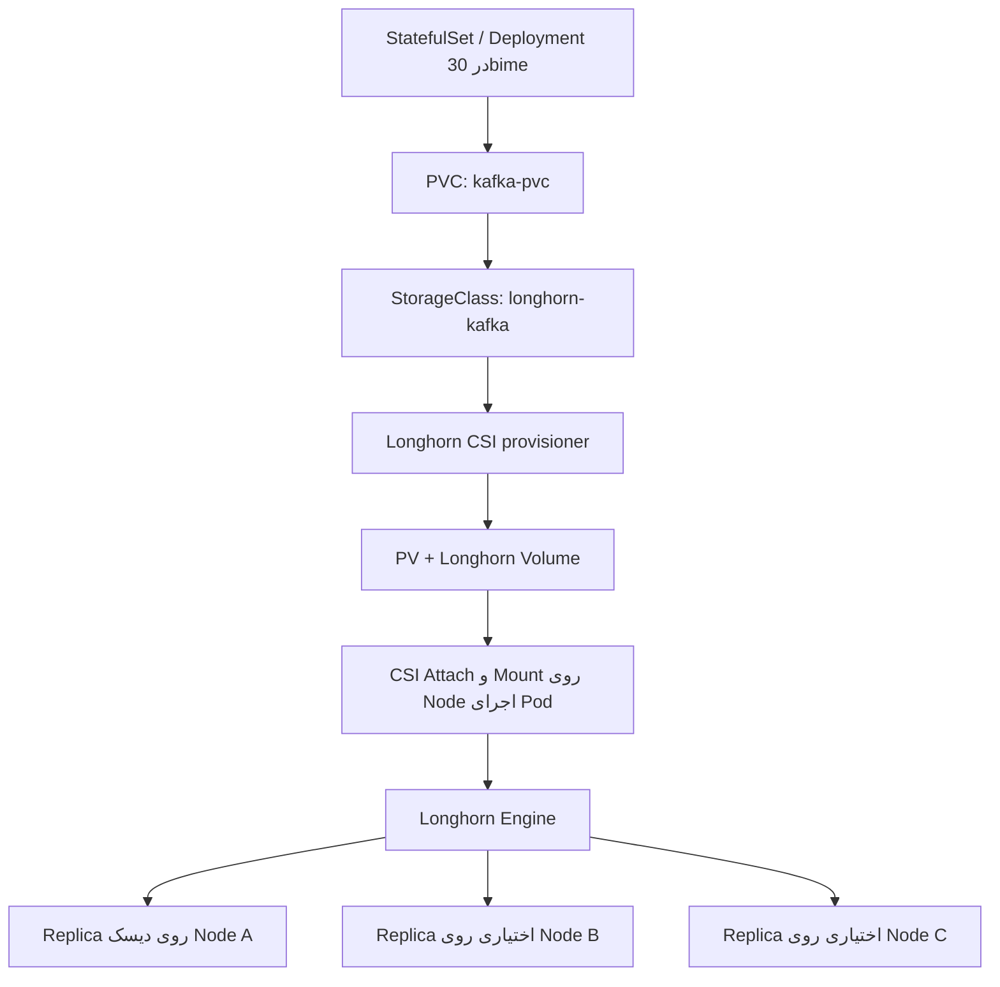

<div dir="rtl" align="right">

# راهنمای جامع Longhorn برای مهندسان DevOps

> **نسخه سند:** 1.0 — 2026-10-24  
> **مبنای فنی:** Longhorn **v1.13.0**، Kubernetes **v1.35.x**، نصب با **Helm 3**، Data Engine **V1**  
> **سناریوی نمونه:** کلاستر `kubeadm`، Traefik، اپلیکیشن‌ها در Namespace `30bime`، Longhorn در Namespace `longhorn-system`، Kafka تک‌نودی با PVC  
> **هدف:** آموزش مفاهیم، الگوهای طراحی، پیکربندی عملیاتی، Runbook، رفع اشکال و Best Practices  
> **دامنه:** راهنمای کاربردی انتخاب و بهره‌برداری؛ **فهرست کامل همه گزینه‌های نسخه‌ای Longhorn نیست**. برای تمام پارامترها بخش «منابع رسمی» را ببینید.

---

## فهرست مطالب

1. خلاصه اجرایی و اصول طلایی
2. مفاهیم Kubernetes Storage و معماری Longhorn
3. مدل HA، Replica و محدودیت‌های آن
4. V1 در برابر V2 و انتخاب Engine
5. طراحی ظرفیت، دیسک، شبکه و Failure Domain
6. پیش‌نیازهای سیستم‌عامل و کلاستر
7. نصب و پیکربندی Longhorn با Helm
8. تنظیمات کلیدی Helm، StorageClass و Global Settings
9. مدیریت Node، Disk، Tag، Scheduling و Worker جدید
10. چرخه عمر Volume، PV، PVC و Access Mode
11. نمونه قابل استفاده برای Kafka در `30bime`
12. Snapshot، Backup، Restore و Disaster Recovery
13. انتشار UI با Traefik و امنیت
14. مانیتورینگ، ظرفیت و هشدارها
15. عملیات روز دوم: Upgrade، Drain، توسعه و حذف نود
16. Runbook عیب‌یابی با سناریوهای واقعی
17. نکات Best Practice و Anti-Pattern
18. چک‌لیست Production و دستورات سریع
19. واژه‌نامه و منابع رسمی

---

## 1. خلاصه اجرایی و اصول طلایی

**Longhorn** یک سیستم **distributed block storage** متن‌باز برای Kubernetes است. به‌کمک CSI Driver، برای PVCها Volume ایجاد می‌کند و داده Volumeها را روی دیسک‌های نودهای واجد شرایط نگه می‌دارد. Longhorn **جایگزین Backup، Replication داخلی دیتابیس یا طراحی HA اپلیکیشن نیست**.

| نیاز | تصمیم مناسب |
|---|---|
| محیط تک‌Worker / توسعه | Data Engine V1 + یک Replica + Backup مستقل، با پذیرش ریسک از دسترس‌رفتن نود |
| دو یا چند Worker با دیسک مناسب | ۲ Replica روی دو نود مستقل برای تعادل هزینه/دسترس‌پذیری؛ بسته به SLO |
| سه یا چند Failure Domain مستقل | ۳ Replica در صورت نیاز به افزونگی بیشتر، ظرفیت و شبکه کافی |
| اپلیکیشن دارای Replication داخلی (مانند Kafka چندبروکری) | بررسی جدی هزینه Replication در لایه Longhorn و اپلیکیشن؛ بنچمارک |
| انتقال Pod بین Workerها | استفاده از CSI + RWO؛ داده باید از نود نگهدارنده Replica قابل دسترس باشد |
| جابه‌جایی و تحمل خرابی نود | چند Replica سالم روی نودهای مجزا **و** قابلیت Schedule شدن Workload |
| داده بسیار حساس | Volume backup به مقصد **خارج از کلاستر** + تمرین Restore + Backup منطقی سازگار با اپلیکیشن |
| Kafka تک‌نودی نمونه این سند | `namespace=30bime`، `PVC=10Gi`، `replicas=1`، `dataLocality=disabled` |

**ده اصل عملیاتی:**

1. از StorageClassهای **اختصاصی هر نوع Workload** استفاده کن؛ StorageClass پیش‌فرض `longhorn` را برای هر تنظیم متفاوت دست‌کاری نکن.
2. Data Plane و Control Plane را تفکیک کن: سلامت UI/Manager به‌تنهایی به معنی قابل استفاده بودن PVC نیست.
3. تعداد Replica را بر اساس Failure Domain، ظرفیت **و** بار I/O انتخاب کن؛ فقط «عدد بزرگ‌تر» بهتر نیست.
4. Snapshot روی همان کلاستر، Backup خارج از کلاستر محسوب نمی‌شود.
5. برای V1 از دیسک اختصاصی ext4/XFS و `open-iscsi` سالم استفاده کن.
6. ساعت تمام نودها را با NTP/Chrony هماهنگ نگه دار؛ TLS Webhook حساس به اختلاف ساعت است.
7. قبل از Upgrade/Drain، سلامت Replica، Backup و وضعیت Attach/Detach را بررسی کن.
8. به‌جای دست‌کاری مستقیم `/var/lib/longhorn`، از API/UI/CSI استفاده کن.
9. UI Longhorn را هرگز بدون Authentication و ترجیحاً TLS/VPN عمومی نکن.
10. **Restore واقعی** را دوره‌ای آزمایش کن؛ موفقیت Job بکاپ کافی نیست.

## 2. مفاهیم Kubernetes Storage و معماری Longhorn

### 2.1. اصطلاحات بنیادین

| جزء | Scope | وظیفه |
|---|---|---|
| `StorageClass` | Cluster | سیاست Provisioning و پارامترهای Volume جدید |
| `PersistentVolume` یا PV | Cluster | شیء نماینده منبع Storage؛ با CSI و Volume واقعی ارتباط دارد |
| `PersistentVolumeClaim` یا PVC | Namespace | درخواست ظرفیت، Access Mode و StorageClass توسط اپلیکیشن |
| CSI Driver | Cluster/Node | ساخت، Publish/Unpublish، Mount، Resize، Snapshot و عملیات وابسته |
| Longhorn Volume | Longhorn CR در `longhorn-system` | منبع Block Storage مدیریت‌شده توسط Longhorn |
| Engine | روی نود دارای Volume متصل | مسیر پردازش خواندن/نوشتن و هماهنگ‌سازی Replicaها |
| Replica | روی دیسک Node | یک نسخه از داده Block Volume |
| Instance Manager | در نود Longhorn | مدیریت پردازش‌های Engine/Replica |
| Share Manager | Kubernetes Pod | ارائه NFS برای Volumeهای RWX |
| Backup Target | خارج از داده اصلی | مقصد بکاپ مانند S3-compatible یا NFS |

**نکته Namespace:** Longhorn خودش در `longhorn-system` نصب می‌شود و CRهای مدیریتی Longhorn هم در آن Namespace هستند. این به معنی اجرا شدن Kafka در آن Namespace نیست: `Kafka`, `Service` و `PVC` در **`30bime`** قرار می‌گیرند. `StorageClass` و `PV` اصلاً Namespace ندارند.

### 2.2. مسیر درخواست تا ذخیره‌سازی



- **RWO Volume** معمولاً به یک Node برای نوشتن Attach می‌شود؛ `ReadWriteOnce` به معنای «فقط یک Pod» نیست، بلکه محدودیت در سطح نود است. برای الزام یک Pod می‌توان `ReadWriteOncePod` را بررسی کرد، مشروط به پشتیبانی CSI/نسخه.
- **RWX Volume** امکان Mount هم‌زمان روی چند Node می‌دهد؛ Longhorn برای RWX فایل‌سیستمی از Share Manager و NFS استفاده می‌کند و رفتار Performance آن با RWO متفاوت است.
- **Engine/Replica** در V1 شبیه «دایرکتوری Kafka روی Worker» نیستند؛ داده یک Block Volume است. برای بررسی فایل‌های Kafka، آن‌ها را **در مسیر Mount داخل Pod** ببین، نه با ویرایش فایل‌های Replica روی Host.
- Statusهای Volume را از دو زاویه بخوان: `state` مانند `attached/detached` و `robustness` مانند `healthy/degraded/faulted`. Volume می‌تواند Attached باشد، ولی Replicaهای کافی برای سلامتی مطلوب نداشته باشد.

### 2.3. Static در برابر Dynamic Provisioning

**Dynamic (پیشنهادی):** ابتدا `StorageClass` و `PVC` می‌سازی؛ CSI خودکار PV و Longhorn Volume ایجاد می‌کند. مناسب GitOps، Helm و StatefulSet.

**Static:** ابتدا در UI یک Longhorn Volume می‌سازی، سپس با «Create PV/PVC» به Kubernetes ارائه می‌کنی. برای داده/Volume موجود یا سناریوی بازیابی مفید است. این روش و Dynamic را روی همان نام PVC هم‌زمان اجرا نکن.

## 3. HA، Replication و محدودیت‌ها

### 3.1. Replication هم‌زمان چیست؟

در V1، Longhorn نوشتن‌های Volume متصل را به Replicaهای سالم ارسال می‌کند. اگر Replica از دسترس خارج شود، Volume ممکن است **Degraded** شود و Longhorn، در صورت وجود Node/Disk واجد شرایط، Replica را Rebuild کند.

- **۱ Replica:** هزینه کمتر؛ از خرابی تنها نود/دیسک نگهدارنده داده محافظت نمی‌کند.
- **۲ Replica روی دو Node:** یک Replica از بین برود، کپی دیگر می‌تواند مبنای ادامه سرویس و Rebuild باشد؛ وضعیت واقعی به اتصال، سلامت Replica و شرایط failover بستگی دارد.
- **۳ Replica روی سه Failure Domain:** تحمل‌پذیری بالاتر در برابر خرابی واحد؛ بهای بیشتر Storage/Network/CPU و تأخیر بالقوه بیشتر.

> `replicas=3` وقتی سه Node مستقل در دسترس نیستند، الزاماً به سه کپی توزیع‌شده سالم منجر نمی‌شود. به‌خصوص Soft Anti-Affinity و تنظیم «Allow Volumes Creation with Degraded Availability» را بررسی کن.

### 3.2. سه نوع دسترس‌پذیری که نباید قاطی شوند

| لایه | مسئولیت | مثال |
|---|---|---|
| Storage HA | Longhorn | داشتن Replica سالم روی نودهای دیگر |
| Workload HA | Kubernetes Scheduling/Controller | زمان‌بندی Pod روی Node سالم؛ StatefulSet تک‌Replica هنوز قطعی دارد |
| Application HA | خود نرم‌افزار | Kafka چندبروکری و Quorum صحیح، Replication Factor مناسب |

Longhorn نمی‌تواند Kafka KRaft تک‌نودی را به کلاستر Kafka مقاوم در برابر خرابی تبدیل کند. حتی در صورت حفظ دیتا، Restart و Recovery سرویس زمان می‌برد.

### 3.3. Data Locality

| مقدار | عملکرد | کاربرد |
|---|---|---|
| `disabled` | تضمینی برای Replica کنار Pod نیست؛ Replica ممکن است روی Node دیگری باشد | انعطاف در Schedule/Attach؛ نمونه این سند |
| `best-effort` | تلاش می‌کند حداقل یک Replica کنار Workload باشد | کاهش هزینه شبکه در صورت وجود Node/Disk مناسب |
| `strict-local` | تنها Replica باید روی همان Node مصرف‌کننده باشد؛ نیازمند `numberOfReplicas=1` | workload با Replication اپلیکیشنی/کارایی محلی؛ نه گزینه عمومی HA |

`disabled` به معنای «چرخش آزاد و تضمین بازیابی دیتا پس از خرابی هر Node» نیست. با یک Replica، اگر Node نگهدارنده از بین برود، صرفاً انتقال Pod کافی نخواهد بود.

### 3.4. Auto Balance و Anti-Affinity

- `replicaAutoBalance=disabled`: پیش‌فرض؛ به‌صورت خودکار برای بالانس جدید جابه‌جا نمی‌کند.
- `least-effort`: حداقل جابه‌جایی لازم برای بهبود پراکندگی؛ معمولاً انتخاب محافظه‌کارانه Production.
- `best-effort`: توزیع متوازن‌تر با احتمال Rebuild و I/O شبکه بیشتر.
- **Replica Node Soft Anti-Affinity = false** برای Production توصیه می‌شود تا Replicaهای یک Volume روی یک Node جمع نشوند.
- **Zone/Disk Soft Anti-Affinity** را بر اساس topology واقعی تنظیم کن؛ `topology.kubernetes.io/zone` باید معنی عملی داشته باشد.
- Volume هنگام ایجاد از StorageClass پارامتر می‌گیرد؛ عوض کردن StorageClass به‌صورت پس‌نگر Volume موجود را تغییر نمی‌دهد.

## 4. Data Engine V1 در برابر V2

| ویژگی | V1 | V2 |
|---|---|---|
| پایه فنی | Engine مبتنی بر فایل‌سیستم Host و iSCSI | SPDK و مسیرهای I/O بهینه‌تر |
| نوع دیسک | Filesystem (`ext4` یا `xfs`) | Raw Block Disk |
| ابزار پیش‌نیاز | `open-iscsi` و Kernel مناسب | پیش‌نیازهای بیشتر از جمله HugePages، Modules، CPU و Kernel سازگار |
| Data Locality `strict-local` | پشتیبانی | پشتیبانی نمی‌شود |
| پیچیدگی راه‌اندازی | کمتر | بیشتر |
| مناسب شروع در این کلاستر | **بله** | فقط بعد از PoC و بنچمارک |

برای V2 در v1.13 مستندات رسمی Kernel **6.7+**، ماژول‌های `vfio_pci`, `uio_pci_generic`, `nvme-tcp`، **2GiB HugePages با اندازه 2MiB** و Raw Block Disk را ذکر می‌کند؛ V2 را روی دیسک فرمت‌شده V1 به‌صورت آزمایشی فعال نکن. اگر V2 لازم شد، مقایسه قابلیت‌ها و محدودیت‌های دقیق v1.13 را مجدداً بررسی کن.

## 5. طراحی ظرفیت، دیسک، شبکه و Failure Domain

### 5.1. محاسبه ظرفیت تقریبی

برای Volumeهای با مصرف نزدیک به ظرفیت اعلام‌شده:

```text
Raw replica capacity ≈ logical provisioned size × replica count
```

مثال: حجم منطقی 100Gi و سه Replica، تا حدود **300Gi ظرفیت اسمی Replica** لازم دارد؛ مصرف واقعی به Thin Provisioning، داده نوشته‌شده، Snapshotها، Rebuild، Reserve و Over-Provisioning بستگی دارد. این فرمول **ضمانت فضای قابل مصرف** نیست.

- `storageOverProvisioningPercentage` روی **فضای قابل Schedule از منظر ظرفیت اسمی** اثر دارد؛ دیسک فیزیکی را بزرگ نمی‌کند.
- `storageMinimalAvailablePercentage` برای حفاظت از فضای آزاد دیسک است، نه quota واقعی هر PVC.
- در هنگام Rebuild باید فضای اضافی موقت وجود داشته باشد.
- رشد Snapshot/Backup و Retention اپلیکیشن را در مدل محاسبه کن.
- حجم PVC را با مصرف واقعی و Headroom پایش کن؛ `10Gi` حجم اولیه برای Kafka Production معمولاً تنها یک مقدار نمونه است.

### 5.2. طرح پیشنهادی Host Disk

```text
worker1:
  /dev/disk/by-id/...  -> ext4 -> /var/lib/longhorn
worker2:
  /dev/disk/by-id/...  -> ext4 -> /var/lib/longhorn
worker3:
  /dev/disk/by-id/...  -> ext4 -> /var/lib/longhorn
```

- برای V1 دیسک اختصاصی، ترجیحاً SSD/NVMe، از Root Filesystem جدا کن.
- برای Mount پایدار از **UUID** در `/etc/fstab` استفاده کن.
- قبل از فرمت کردن دیسک: `lsblk -f`, `blkid`, `findmnt` و شناسایی دقیق `/dev/disk/by-id/...` الزامی است؛ `mkfs` **داده را پاک می‌کند**.
- فایل‌سیستم دیسک Host و فایل‌سیستم **داخل Volume** دو موضوع مستقل‌اند؛ هر دو ممکن است ext4 باشند.
- اگر فایل‌سیستم تازه را روی مسیر دارای داده Longhorn Mount کنی، داده قبلی پشت Mount پنهان می‌شود؛ بدون طرح مهاجرت این کار ممنوع.

### 5.3. شبکه، تأخیر و Failure Domain

مسیر I/O یک Pod با Replica راه‌دور شامل ترافیک شبکه بین Workerهاست. به همین دلیل latency، packet loss، oversubscription و Bandwidth مستقیماً بر Performance اثر می‌گذارند.

- برای Production حساس به I/O، شبکه 10GbE و ترجیحاً Storage Network جداگانه را **به‌عنوان هدف طراحی** بررسی کن؛ الزام مطلق هر کلاستر نیست.
- CNI (در این کلاستر Calico)، MTU، Firewall و DNS باید ارتباط Pod/Nodeهای Longhorn را پشتیبانی کنند.
- Portهای داخلی را بر اساس [Longhorn Networking Reference](https://longhorn.io/docs/1.13.0/references/networking/) باز کن؛ کورکورانه تمام پورت‌ها را روی اینترنت باز نکن.
- Replicaهای یک Volume ترجیحاً در Node، Rack یا Zone مستقل باشند. برچسب `topology.kubernetes.io/zone` فقط زمانی مفید است که نودها واقعاً در Failure Domainهای مجزا قرار داشته باشند.

## 6. پیش‌نیازها و کنترل سلامت

### 6.1. بررسی Kubernetes و Helm

```bash
kubectl version --client
kubectl version                       # Server Version را هم بررسی کن
kubectl get nodes -o wide
kubectl get storageclass
helm version
kubectl get ingressclass
kubectl get pods -A | grep -i traefik
```

نسخه `kubeadm version` به‌تنهایی ثابت نمی‌کند API Server همان نسخه است. Longhorn v1.13.0 مطابق مستندات رسمی Kubernetes 1.34 به بالا را می‌خواهد؛ نسخه واقعی API Server و Release Notes همان Longhorn را کنترل کن.

### 6.2. پیش‌نیاز Host در Ubuntu/Debian برای V1

روی **هر Node که باید Longhorn Volume را Host یا Mount کند**:

```bash
sudo apt-get update
sudo apt-get install -y open-iscsi nfs-common curl bash gawk grep util-linux
sudo modprobe iscsi_tcp
sudo systemctl enable --now iscsid
sudo systemctl status iscsid --no-pager
which iscsiadm
lsmod | grep iscsi_tcp
lsblk -f
df -hT
```

- `nfs-common` برای RWX مهم است؛ `open-iscsi` و `iscsid` برای V1/RWO حیاتی‌اند.
- **از open-iscsi نسخه 2.1.12 استفاده نکن**؛ طبق هشدار رسمی Longhorn، این نسخه می‌تواند Attach را مختل کند. از نسخه `<=2.1.11` یا `>=2.1.13` استفاده کن.
- `multipathd` باید دستگاه‌های Longhorn را از دست‌کاری خود مستثنا کند؛ دستورهای خام غیرفعال‌سازی روی سروری که به Multipath SAN نیاز دارد ممکن است مخرب باشند.
- Runtime باید Mount Propagation و اجرای مؤلفه‌های دارای دسترسی Privileged را اجازه دهد.
- `chrony` یا NTP پایدار روی **تمام Control Planeها و Workerها** لازم است.

### 6.3. کنترل همگامی ساعت؛ درس آموخته‌شده از نصب این کلاستر

خطای مشاهده‌شده هنگام نصب شما:

```text
x509: certificate has expired or is not yet valid
current time ... is before certificate NotBefore
longhorn-manager -> CrashLoopBackOff
longhorn-driver-deployer -> Init: waiting
```

علت تشخیص‌داده‌شده: **Clock Skew** میان اعتبارسنج TLS و صادرکننده Certificate مربوط به Longhorn Webhook.

```bash
# روی همه نودها
date -u
timedatectl status
chronyc tracking
chronyc sources -v
```

روی Debian/Ubuntu با دسترسی به منبع NTP معتبر:

```bash
sudo apt-get install -y chrony
sudo systemctl enable --now chrony
chronyc sources -v
# فقط پس از تأیید منبع زمانی معتبر و ارزیابی اثر روی سرویس‌های حساس:
sudo chronyc makestep
```

**همگام بودن Timezone الزامی نیست؛ همگام بودن UTC واقعی الزامی است.** در Control Plane پرکار، تغییر ناگهانی ساعت را در پنجره نگهداری انجام بده.

### 6.4. Preflight رسمی

```bash
curl -sSfL -o longhornctl \
  https://github.com/longhorn/cli/releases/download/v1.13.0/longhornctl-linux-amd64
chmod +x longhornctl
./longhornctl check preflight
```

اگر V2 را ارزیابی می‌کنی:

```bash
./longhornctl check preflight --enable-spdk
```

از نتایج `WARN/ERROR` چشم‌پوشی نکن. این کنترل جایگزین بنچمارک، برنامه بکاپ یا تست واقعی PVC نیست.

## 7. نصب و پیکربندی با Helm

### 7.1. نسخه‌ها و جداسازی Namespace

```bash
helm repo add longhorn https://charts.longhorn.io
helm repo update
helm search repo longhorn/longhorn --versions | head
kubectl create namespace longhorn-system --dry-run=client -o yaml | kubectl apply -f -
```

Longhorn باید در `longhorn-system` بماند؛ نام Namespace مصرف‌کنندگان مثل Kafka می‌تواند `30bime` باشد.

### 7.2. نمونه `values-longhorn.yaml` برای نصب جدید V1

> **مهم:** این فایل برای نصب **جدید** نمونه است، نه اعمال بی‌ملاحظه روی کلاستر موجود دارای Volume. قبل از Upgrade، `helm get values` را بررسی کن. مقادیر سیاستی را بر اساس Node/Capacity تنظیم کن.

```yaml
# values-longhorn.yaml
# Longhorn 1.13.0 / Engine V1

defaultSettings:
  defaultDataPath: /var/lib/longhorn
  defaultReplicaCount: 1                  # UI-created volume default; NOT StorageClass override
  defaultDataLocality: disabled
  replicaAutoBalance: least-effort
  replicaSoftAntiAffinity: false
  storageOverProvisioningPercentage: 100
  storageMinimalAvailablePercentage: 25
  # For V1 and a new installation only
  v1DataEngine: true

persistence:
  defaultClass: false                    # longhorn StorageClass exists, but not cluster default
  defaultClassReplicaCount: 1           # default Longhorn StorageClass
  defaultDataLocality: disabled
  defaultFsType: ext4
  reclaimPolicy: Retain
```

**تفاوت حساس:** `defaultSettings.defaultReplicaCount` برای Volumeهایی است که مستقیماً از UI ساخته می‌شوند؛ `persistence.defaultClassReplicaCount` برای StorageClass پیش‌فرض ایجادشده در Helm است؛ و `StorageClass.parameters.numberOfReplicas` برای Volume جدید ایجادشده از **همان StorageClass** اولویت دارد.

نسخه واقعی Chart را با نسخه انتخاب‌شده Lock کن و پیش از نصب Diff بگیر:

```bash
helm show values longhorn/longhorn --version 1.13.0 > longhorn-chart-defaults.yaml
helm template longhorn longhorn/longhorn \
  --namespace longhorn-system --version 1.13.0 \
  -f values-longhorn.yaml > rendered-longhorn.yaml
```

### 7.3. نصب

```bash
helm upgrade --install longhorn longhorn/longhorn \
  --namespace longhorn-system --create-namespace \
  --version 1.13.0 -f values-longhorn.yaml \
  --wait --timeout 15m
```

سپس:

```bash
helm status longhorn -n longhorn-system
kubectl -n longhorn-system get pods -o wide
kubectl -n longhorn-system get deploy,ds,svc
kubectl get csidriver
kubectl get storageclass
kubectl -n longhorn-system get nodes.longhorn.io
```

**معیار قبولی:** Podهای Manager/CSI آماده‌اند، CSI Driver ثبت شده، نودهای Longhorn Storage قابل Scheduling دارند و **تست واقعی PVC/Pod/Write/Read** موفق است. UI سالم به‌تنهایی معیار قبول نیست.

### 7.4. تغییرات بعد از نصب

```bash
helm get values longhorn -n longhorn-system -a > longhorn-effective-values.yaml
helm history longhorn -n longhorn-system
helm diff --help  # فقط اگر helm-diff plugin نصب است
```

مقادیر Global Settings ممکن است از UI یا CRD تغییر کرده باشند؛ Drift بین Helm/GitOps و UI را ثبت کن. پیش از اعمال `helm upgrade` از تفاوت مقدار قبلی/جدید مطمئن شو.

## 8. مرجع تنظیمات کلیدی

### 8.1. Helm / Global Settings

| کلید | مفهوم | هشدار/تصمیم |
|---|---|---|
| `defaultSettings.defaultDataPath` | مسیر پیش‌فرض روی Host برای V1 | مسیر باید Mount پایدار و فضای کافی داشته باشد |
| `defaultSettings.defaultReplicaCount` | Replica پیش‌فرض UI | روی StorageClass اختصاصی به‌تنهایی اثر ندارد |
| `persistence.defaultClassReplicaCount` | Replica کلاس `longhorn` تولیدشده با Helm | برای کلاس‌های اختصاصی override می‌شود |
| `defaultSettings.defaultDataLocality` | Locality پیش‌فرض | `best-effort` برای کاهش ترافیک در شرایط مناسب؛ `disabled` منع locality ندارد |
| `defaultSettings.replicaAutoBalance` | توزیع Replicaها هنگام تغییر نودها | `least-effort` محافظه‌کارانه |
| `defaultSettings.replicaSoftAntiAffinity` | اجازه چند Replica همان Volume روی یک Node | برای HA واقعی Production معمولاً `false` |
| `defaultSettings.replicaZoneSoftAntiAffinity` | نرمی قید Zone | بر اساس Failure Domain واقعی |
| `defaultSettings.storageOverProvisioningPercentage` | درصد Over-Provisioning منطقی | ظرفیت واقعی خلق نمی‌کند |
| `defaultSettings.storageMinimalAvailablePercentage` | کف فضای آزاد برای Scheduling | پیش‌فرض 25%; از DiskFull جلوگیری مطلق نمی‌کند |
| `defaultSettings.createDefaultDiskLabeledNodes` | ساخت Default Disk فقط برای Nodeهای Labelدار | مفید برای کنترل اضافه شدن خودکار Node |
| `defaultSettings.nodeDownPodDeletionPolicy` | رفتار نسبت به Pod روی Node از دست‌رفته | قبل از تغییر اثر روی Databases/Detach را مطالعه کن |
| `defaultSettings.disableSchedulingOnCordonedNode` | Storage Scheduling روی Node Cordon شده | معمولاً با عملیات Drain همراه است |
| `defaultSettings.backupTarget` / `backupTargetCredentialSecret` | مقصد و Secret بکاپ | Secret در `longhorn-system` |
| `defaultSettings.snapshotMaxCount` | سقف Snapshotهای Volume | Retention/cleanup را مانیتور کن |
| `defaultSettings.autoSalvage` | ریکاوری خودکار برخی حالت‌های Faulted | فعال‌سازی بدون Runbook خطر انتخاب داده نامناسب را دارد |
| `defaultSettings.deletingConfirmationFlag` | حفاظت Uninstall | برای حذف ایمن Longhorn به‌صورت آگاهانه کنترل می‌شود |
| `csi.*ReplicaCount` | Replicaهای کنترلر CSI | این‌ها تعداد **Replica داده Volume** نیستند |
| `longhornManager.*` / `longhornUI.*` | تنظیم Scheduling/Resources/Service اجزای Longhorn | جدای از StorageClass |

**چطور مقدار جاری یک Setting را بخوانیم؟**

```bash
kubectl -n longhorn-system get settings.longhorn.io
kubectl -n longhorn-system get settings.longhorn.io replica-auto-balance -o yaml
kubectl -n longhorn-system get settings.longhorn.io default-data-path -o jsonpath='{.value}{"\n"}'
```

> تغییر Settingهای حساس به‌ویژه سیاست‌های Salvage/Detach/NodeDown را صرفاً پس از مطالعه مستندات همان نسخه و شناسایی Volumeهای موجود انجام بده.

### 8.2. پارامترهای StorageClass

| پارامتر | نمونه | اثر |
|---|---|---|
| `numberOfReplicas` | `"1"`, `"2"`, `"3"` | تعداد کپی Volume جدید |
| `dataEngine` | `"v1"` | انتخاب Data Engine |
| `dataLocality` | `"disabled"`, `"best-effort"`, `"strict-local"` | رابطه محل Pod و Replica |
| `fsType` | `"ext4"` یا `"xfs"` | فرمت فایل‌سیستم داخل Volume |
| `diskSelector` | `"ssd,fast"` | Tagهای Longhorn Disk (نه Kubernetes labels) |
| `nodeSelector` | `"storage,fast"` | Tagهای Longhorn Node (نه Pod `nodeSelector`) |
| `replicaAutoBalance` | `"ignored"`, `"least-effort"` | Override تعادل Replica |
| `encrypted` | `"false"` | فعال‌سازی Encryption، نیازمند Secret/مدیریت Key |
| `staleReplicaTimeout` | `"2880"` | زمان اعلام Replica خراب به‌صورت Stale (دقیقه) |
| `recurringJobSelector` | JSON String | تخصیص Jobها/Groupها به Volumeهای جدید |
| `fromBackup` | URL بکاپ | Restore هنگام Provisioning |

**قوانین:** `provisioner: driver.longhorn.io`، `reclaimPolicy: Retain/Delete` و `allowVolumeExpansion: true` در سطح StorageClass هستند. برای Dynamic Provisioning معمولی `volumeBindingMode: Immediate` مناسب است؛ برای Topology-aware provisioning بر اساس Zone، مستندات Longhorn `WaitForFirstConsumer` را توصیه می‌کنند. StorageClass و اکثر پارامترهای آن را برای Volumeهای موجود immutable/غیرقابل‌اثرِ پس‌نگر فرض کن و به‌جای ویرایش، کلاس نسخه‌بندی‌شده جدید بساز.

## 9. Node، Disk، Tag و Worker جدید

### 9.1. اضافه شدن Worker جدید

با Join شدن Worker به Kubernetes، Longhorn Manager معمولاً نود جدید را کشف می‌کند. در تنظیم پیش‌فرض، دیسک Filesystem در `/var/lib/longhorn` روی نود جدید ساخته/ثبت می‌شود **به شرط فعال بودن قابلیت ساخت دیسک پیش‌فرض، پیش‌نیازها، فضای سالم و Scheduling**.

```bash
kubectl get nodes -o wide
kubectl -n longhorn-system get nodes.longhorn.io
kubectl -n longhorn-system get pods -o wide
# روی worker جدید
lsblk -f
findmnt /var/lib/longhorn
df -h /var/lib/longhorn
systemctl is-active iscsid
```

**کشف Node ≠ کشف هر دیسک جدید به‌صورت خودکار.** اگر 100Gi دیسک ثانویه روی `/mnt/longhorn-disk2` Mount کردی، از UI در `Nodes → workerX → Edit Disks → Add Disk` آن مسیر را معرفی کن یا از روش Configuration-as-Code مستندات استفاده کن. برای V1 مسیر باید فایل‌سیستم ext4/XFS Mount شده باشد.

### 9.2. الگوی عملی برای افزودن دیسک دوم

```bash
# روی Worker: فقط با دستورهای غیرمخرب شروع کن
lsblk -f
sudo blkid
findmnt
sudo mkdir -p /mnt/longhorn-disk2
```

از فرمت و Mount دیسک مطمئن شو؛ پس از ثبت UUID در `/etc/fstab` و Mount موفق، آن را در UI اضافه کن. **دیسک حاوی اطلاعات را مجدداً `mkfs` نکن.** اگر جای دیگری به عنوان `/var/lib/longhorn` Mount شده است، به‌جای افزودن همان فایل‌سیستم به دو Disk entry، مسیرها را شفاف نگه دار.

### 9.3. Disk/Node Tags و Scheduling

مثال: برای SSDها Tag به نام `ssd` و برای Nodeهای ذخیره‌سازی Tag به نام `storage` در داشبورد Longhorn ایجاد کن. سپس StorageClass اختصاصی:

```yaml
apiVersion: storage.k8s.io/v1
kind: StorageClass
metadata:
  name: longhorn-fast
provisioner: driver.longhorn.io
reclaimPolicy: Retain
allowVolumeExpansion: true
volumeBindingMode: Immediate
parameters:
  numberOfReplicas: "2"
  fsType: "ext4"
  dataEngine: "v1"
  dataLocality: "best-effort"
  nodeSelector: "storage"
  diskSelector: "ssd"
```

`nodeSelector` **داخل پارامترهای StorageClass** با `spec.template.spec.nodeSelector` در Pod یکی نیست. اولی مکان **Replicaهای داده** را محدود می‌کند، دومی مکان اجرای **Pod اپلیکیشن** را.

### 9.4. افزایش Replicaهای Volume موجود

تغییر `numberOfReplicas` در StorageClass قدیمی کافی نیست. Volume موجود را از Longhorn UI (Volume → Edit → Number of Replicas) یا API مدیریت کن؛ قبل از افزایش ظرفیت، Node/Diskهای واجد شرایط و فضای Rebuild را بررسی کن. تا کامل‌شدن Rebuild ممکن است Volume `Degraded` باشد.

## 10. چرخه عمر Volume / PV / PVC

### 10.1. ساخت Dynamic PVC برای تست

```yaml
apiVersion: v1
kind: Namespace
metadata:
  name: 30bime
---
apiVersion: storage.k8s.io/v1
kind: StorageClass
metadata:
  name: longhorn-app-rwo
provisioner: driver.longhorn.io
reclaimPolicy: Retain
allowVolumeExpansion: true
volumeBindingMode: Immediate
parameters:
  numberOfReplicas: "1"
  dataEngine: "v1"
  dataLocality: "disabled"
  fsType: "ext4"
---
apiVersion: v1
kind: PersistentVolumeClaim
metadata:
  name: test-pvc
  namespace: 30bime
spec:
  accessModes: [ReadWriteOnce]
  storageClassName: longhorn-app-rwo
  resources:
    requests:
      storage: 1Gi
```

```bash
kubectl apply -f test-storage.yaml
kubectl -n 30bime get pvc test-pvc -o wide
kubectl get pv
kubectl -n longhorn-system get volumes.longhorn.io
```

PVC `Bound` فقط Provisioning را ثابت می‌کند؛ تست Mount/Write لازم است.

### 10.2. تست واقعی I/O و Persistency

```yaml
apiVersion: v1
kind: Pod
metadata:
  name: storage-smoke-test
  namespace: 30bime
spec:
  restartPolicy: Never
  containers:
    - name: test
      image: busybox:1.36
      command: ["sh", "-c", "echo longhorn-ok > /data/health.txt; sleep 3600"]
      volumeMounts:
        - name: data
          mountPath: /data
  volumes:
    - name: data
      persistentVolumeClaim:
        claimName: test-pvc
```

```bash
kubectl apply -f smoke-pod.yaml
kubectl -n 30bime wait --for=condition=Ready pod/storage-smoke-test --timeout=180s
kubectl -n 30bime exec storage-smoke-test -- cat /data/health.txt
kubectl -n 30bime delete pod storage-smoke-test
# برای بررسی دوام محتوا، Pod دوم را با همان PVC و بدون overwrite کردن health.txt بساز.
```

### 10.3. Reclaim Policy و حذف

- `Delete`: بعد از حذف Claim و طی Reclaim، Volume پشتیبان می‌تواند حذف شود؛ **برای داده حساس خطرناک است**.
- `Retain`: حذف PVC نباید به پاک‌شدن خودکار داده Volume منجر شود، ولی PV ممکن است `Released` بماند و برای استفاده مجدد به عملیات مدیریتی نیاز باشد.
- **PVC تازه با همان نام** الزاماً به PV قدیمی `Released` Bind نمی‌شود.
- عملیات Clean-up را فقط پس از شناسایی PV، Handle CSI، Volume و Backup انجام بده.

### 10.4. Resize

ابتدا `allowVolumeExpansion: true` لازم است؛ سپس:

```bash
kubectl -n 30bime patch pvc test-pvc --type merge \
  -p '{"spec":{"resources":{"requests":{"storage":"2Gi"}}}}'
kubectl -n 30bime get pvc test-pvc -w
kubectl -n 30bime describe pvc test-pvc
```

ممکن است Resize فایل‌سیستم به مراحل CSI/Node و وضعیت Mount وابسته باشد. **Shrink کردن PVC با تغییر `requests.storage` پشتیبانی عمومی ندارد**؛ برای کوچک‌سازی روی Migration/Restore برنامه‌ریزی کن.

### 10.5. RWX و تفاوت با RWO

- RWO برای Kafka، دیتابیس‌ها و یک Writer غالباً انتخاب بهتر است.
- RWX برای سناریوی Share بین Nodeها از NFS Share Manager استفاده می‌کند؛ به `nfs-common` و بررسی Performance/Failure نیاز دارد.
- RWX راه‌حل Multi-Writer برای Kafka Data Directory نیست؛ Kafka Brokerهای مجزا نباید یک `log.dirs` مشترک را هم‌زمان بنویسند.

## 11. Kafka روی Longhorn در Namespace `30bime`

### 11.1. سناریو و محدودیت‌ها

این نمونه **Kafka تک‌نودی KRaft** با Image `confluentinc/cp-kafka:7.8.3` است. Volume پویا از Longhorn می‌گیرد، Pod به Worker خاصی Pin نشده و Service داخلی برای اتصال در `30bime` دارد. **برای Production مقاوم در برابر خرابی نیست**.

> اگر قبلاً `kafka-pvc` را ساخته‌ای یا Kafka با دیتای واقعی روی PV دیگری اجراست، قبل از Apply، Migration را طراحی کن. نمونه زیر برای **استقرار جدید** است؛ هیچ Manifestی به‌تنهایی داده‌های قدیمی را منتقل نمی‌کند.

### 11.2. نمونه کامل `kafka.yaml`

```yaml
apiVersion: v1
kind: Namespace
metadata:
  name: 30bime
---
apiVersion: storage.k8s.io/v1
kind: StorageClass
metadata:
  name: longhorn-kafka
provisioner: driver.longhorn.io
reclaimPolicy: Retain
allowVolumeExpansion: true
volumeBindingMode: Immediate
parameters:
  numberOfReplicas: "1"
  dataLocality: "disabled"
  dataEngine: "v1"
  fsType: "ext4"
---
apiVersion: v1
kind: PersistentVolumeClaim
metadata:
  name: kafka-pvc
  namespace: 30bime
spec:
  accessModes: [ReadWriteOnce]
  storageClassName: longhorn-kafka
  resources:
    requests:
      storage: 10Gi
---
apiVersion: v1
kind: Service
metadata:
  name: kafka
  namespace: 30bime
spec:
  clusterIP: None
  publishNotReadyAddresses: true
  selector:
    app: kafka
  ports:
    - name: broker
      port: 9092
      targetPort: 9092
    - name: controller
      port: 9093
      targetPort: 9093
---
apiVersion: apps/v1
kind: StatefulSet
metadata:
  name: kafka
  namespace: 30bime
spec:
  serviceName: kafka
  replicas: 1
  selector:
    matchLabels:
      app: kafka
  template:
    metadata:
      labels:
        app: kafka
    spec:
      terminationGracePeriodSeconds: 60
      securityContext:
        runAsUser: 1000
        runAsGroup: 1000
        fsGroup: 1000
      containers:
        - name: kafka
          image: confluentinc/cp-kafka:7.8.3
          ports:
            - name: broker
              containerPort: 9092
            - name: controller
              containerPort: 9093
          env:
            - name: KAFKA_NODE_ID
              value: "1"
            - name: KAFKA_PROCESS_ROLES
              value: "broker,controller"
            - name: KAFKA_LISTENERS
              value: "PLAINTEXT://0.0.0.0:9092,CONTROLLER://0.0.0.0:9093"
            - name: KAFKA_ADVERTISED_LISTENERS
              value: "PLAINTEXT://kafka.30bime.svc.cluster.local:9092"
            - name: KAFKA_CONTROLLER_LISTENER_NAMES
              value: "CONTROLLER"
            - name: KAFKA_CONTROLLER_QUORUM_VOTERS
              value: "1@kafka-0.kafka.30bime.svc.cluster.local:9093"
            - name: KAFKA_LISTENER_SECURITY_PROTOCOL_MAP
              value: "CONTROLLER:PLAINTEXT,PLAINTEXT:PLAINTEXT"
            - name: KAFKA_INTER_BROKER_LISTENER_NAME
              value: "PLAINTEXT"
            - name: KAFKA_OFFSETS_TOPIC_REPLICATION_FACTOR
              value: "1"
            - name: KAFKA_TRANSACTION_STATE_LOG_REPLICATION_FACTOR
              value: "1"
            - name: KAFKA_TRANSACTION_STATE_LOG_MIN_ISR
              value: "1"
            - name: KAFKA_GROUP_INITIAL_REBALANCE_DELAY_MS
              value: "0"
            - name: CLUSTER_ID
              value: "MkU3OEVBNTcwNTJENDM2Qg"
            # مهم: زیرپوشه روی Volume، نه ریشه ext4
            - name: KAFKA_LOG_DIRS
              value: "/var/lib/kafka/data/kafka-logs"
          volumeMounts:
            - name: kafka-data
              mountPath: /var/lib/kafka/data
          startupProbe:
            exec:
              command: ["/bin/bash", "-c", "kafka-broker-api-versions --bootstrap-server localhost:9092 >/dev/null 2>&1"]
            periodSeconds: 15
            timeoutSeconds: 10
            failureThreshold: 10
          readinessProbe:
            exec:
              command: ["/bin/bash", "-c", "kafka-broker-api-versions --bootstrap-server localhost:9092 >/dev/null 2>&1"]
            periodSeconds: 15
            timeoutSeconds: 10
            failureThreshold: 5
          livenessProbe:
            exec:
              command: ["/bin/bash", "-c", "kafka-broker-api-versions --bootstrap-server localhost:9092 >/dev/null 2>&1"]
            periodSeconds: 30
            timeoutSeconds: 10
            failureThreshold: 5
          resources:
            requests:
              cpu: 250m
              memory: 1Gi
            limits:
              cpu: "1"
              memory: 2Gi
      volumes:
        - name: kafka-data
          persistentVolumeClaim:
            claimName: kafka-pvc
```

**نکته‌های مهم Manifest:**

- `StorageClass` Cluster-scoped است؛ PVC، Service و StatefulSet در `30bime` هستند.
- اگر `longhorn-kafka` قبلاً با پارامترهای دیگر ساخته شده، آن را بی‌محابا Replace نکن؛ کلاس جدید مثل `longhorn-kafka-v2` بساز و مهاجرت را جداگانه مدیریت کن.
- `KAFKA_ADVERTISED_LISTENERS` آدرس DNS کامل دارد؛ برای Clientهای سایر Namespaceها مناسب‌تر است.
- `KAFKA_CONTROLLER_QUORUM_VOTERS` به StatefulSet Pod DNS اشاره می‌کند.
- `CLUSTER_ID` باید برای KRaft Cluster ثابت بماند؛ برای Cluster جدید مقدار معتبر بساز، برای Volume قبلی خودسرانه عوض نکن.
- `runAsUser/runAsGroup/fsGroup=1000` فرض سازگاری Image/Volume است؛ اگر Permission Error رخ داد UID/GID داخل Image را تأیید کن.
- منابع CPU/RAM نمونه‌اند؛ Kafka Heap، Page Cache، Disk IOPS و Retention باید جداگانه Capacity Plan شوند.
- Namespace `30bime` باعث Namespaceدار شدن Longhorn itself نمی‌شود.

### 11.3. علت خطای `lost+found`

در اولین اجرای Kafka شما خطایی شبیه این رخ داد:

```text
Found directory /var/lib/kafka/data/lost+found
'lost+found' is not in the form of topic-partition...
```

دلیل: ریشه فایل‌سیستم ext4 دارای `lost+found` است؛ Kafka انتظار دارد مسیر `log.dirs` فقط داده قابل تشخیص Kafka باشد. راهکار **استفاده از زیرپوشه** است:

```text
/var/lib/kafka/data/              <- PVC mount (ext4 root)
  lost+found/
  kafka-logs/                     <- KAFKA_LOG_DIRS
    meta.properties
    __cluster_metadata-0/
    ...
```

نیازی به حذف `lost+found` یا حذف PVC نیست؛ ولی اگر داده Kafka قبلاً در ریشه Volume نوشته شده، قبل از تغییر مسیر باید Migration/Backup انجام دهی.

### 11.4. اجرا و تست

```bash
kubectl apply -f kafka.yaml
kubectl -n 30bime rollout status statefulset/kafka --timeout=180s
kubectl -n 30bime get pods,pvc,svc -o wide
kubectl -n 30bime logs kafka-0 --tail=100
kubectl -n 30bime exec kafka-0 -- df -h /var/lib/kafka/data
kubectl -n 30bime exec kafka-0 -- kafka-topics --bootstrap-server localhost:9092 --list
kubectl -n longhorn-system get volumes.longhorn.io
```

**داخل Namespace:** `kafka:9092`. **از Namespace دیگر:** `kafka.30bime.svc.cluster.local:9092`. این Listener فقط داخل کلاستر است؛ برای Client خارجی باید Listener جداگانه و آدرس Advertise قابل دسترس در آن شبکه طراحی شود.

## 12. Snapshot، Backup، Restore و DR

### 12.1. تعریف دقیق

- **Snapshot:** نقطه بازگشت در همان سامانه Volume. Snapshot لزوماً در برابر نابودی کلاستر/دیسک‌ها محافظت نمی‌کند.
- **Backup:** کپی داده Snapshot به Backupstore خارجی (S3-compatible، NFS و گزینه‌های پشتیبانی‌شده). برای Disaster Recovery مناسب‌تر است.
- **DR Volume:** Volume آماده بازیابی در **کلاستر دوم** بر پایه Backupهای دوره‌ای در Backup Target مشترک؛ RPO به فاصله Backupها وابسته است.
- **System Backup:** تنظیمات/منابع مدیریتی Longhorn را پوشش می‌دهد و جای Backup داده Volumeها یا Snapshot etcd را نمی‌گیرد.
- **Application-consistent Backup:** برای Kafka/Database، Snapshot صرفاً crash-consistent می‌تواند باشد؛ رفتار Flush/Checkpoint، Metadata Quorum و برنامه Backup منطقی/Replication را باید جداگانه در نظر گرفت.

### 12.2. پیکربندی S3-Compatible Backup Target

مثال زیر **Placeholders** است؛ Credentials واقعی را در Git قرار نده.

```bash
kubectl -n longhorn-system create secret generic longhorn-s3-credentials \
  --from-literal=AWS_ACCESS_KEY_ID='REPLACE_ME' \
  --from-literal=AWS_SECRET_ACCESS_KEY='REPLACE_ME' \
  --from-literal=AWS_ENDPOINTS='https://s3.example.internal'
```

در UI مسیر `Backup and Restore → Backup Targets`، مقصد را طبق Provider ست کن:

```text
Name: default
URL: s3://my-longhorn-backups@us-east-1/longhorn/
Credential Secret: longhorn-s3-credentials
```

- URI برای S3 باید Region و `/` مناسب داشته باشد.
- برای MinIO/Ceph RGW و S3 غیر AWS ممکن است `AWS_ENDPOINTS`، Certificate trust و virtual-host/path-style نیازمند تنظیم بیشتر باشد.
- Backupstore واقعاً باید **خارج از Failure Domain کلاستر اصلی** باشد؛ MinIO تنها روی همان Worker نسخه پشتیبان مستقل نیست.
- مجوزهای Bucket را حداقلی تنظیم کن و Versioning/Retention/Immutability را در سمت مقصد بر اساس Threat Model اعمال کن.
- بکاپ آزمایشی بگیر و **Restore آن را در PVC تازه** انجام بده.

### 12.3. RecurringJob نمونه

```yaml
apiVersion: longhorn.io/v1beta2
kind: RecurringJob
metadata:
  name: kafka-nightly-backup
  namespace: longhorn-system
spec:
  cron: "0 2 * * *"
  task: "backup"
  groups:
    - kafka-critical
  retentionPolicy: count-based
  retain: 7
  concurrency: 1
```

این Job فقط پس از **تخصیص به Volume/PVC/StorageClass مرتبط** اجرا می‌شود. صرف ساخت RecurringJob به معنای Backup خودکار تمام Volumeها نیست.

یکی از روش‌های Assign روی PVC (مطابق مستندات انتخاب RecurringJob) استفاده از Labelهاست؛ قبل از اعمال روی داده حساس، Selector دقیق نسخه را از [Recurring Snapshots and Backups](https://longhorn.io/docs/1.13.0/snapshots-and-backups/scheduling-backups-and-snapshots/) بررسی کن. راه ساده‌تر و کم‌اشتباه‌تر: از UI روی Volume مربوط به Kafka، Job Group `kafka-critical` را به آن اختصاص بده و اولین اجرای Job را کنترل کن.

**در v1.13** Retention از نوع `age-based` نیز پشتیبانی می‌شود؛ مثال:

```yaml
# فقط فیلدهای مربوط به retention در spec
retentionPolicy: age-based
retainAge: "168h"
```

این روش را با `count-based` هم‌زمان ترکیب نکن؛ فقط سیاست انتخابی معتبر است. Cron timezone پیش‌فرض Scheduler را بررسی کن و ساعت اجرای Backupها را با پیک ترافیک هماهنگ نکن.

### 12.4. Restore Drill پیشنهادی

1. بکاپ سالم و زمان آن را انتخاب و RPO را ثبت کن.
2. از Longhorn UI یک **Volume جدید** از Backup بساز؛ Volume اصلی را Overwrite نکن.
3. برای Volume جدید PV/PVC استاتیک یا روش Restore-into-PVC مستند را ایجاد کن.
4. یک Pod تست **بدون Writer هم‌زمان روی Volume اصلی** بالا بیاور.
5. فایل‌سیستم و داده را اعتبارسنجی کن؛ برای Kafka، Metadata، Topicها و سازگاری Cluster ID و Node ID را بررسی کن.
6. زمان عملیات را به عنوان RTO ثبت کن؛ نتیجه را مستندسازی کن.

**RPO:** حداکثر داده‌ای که با Backup schedule می‌توان از دست داد. **RTO:** زمان لازم برای بازگشت سرویس. هر دو را با آزمایش بسنج، نه با فرض.

## 13. دسترسی UI با Traefik و امنیت

### 13.1. اصل معماری

UI و Backend Longhorn در `longhorn-system` هستند؛ Traefik فقط دسترسی مدیریتی می‌دهد. **Longhorn UI به‌صورت پیش‌فرض Authentication داخلی فعال ندارد.**

**توصیه:** دامنه `longhorn.30bime.ir` را پشت **HTTPS + Auth + ترجیحاً VPN/IP Allowlist** منتشر کن. `http://` تنها برای آزمایش روی شبکه قابل اعتماد؛ Basic Auth روی HTTP امن نیست.

### 13.2. پیش‌نیاز Traefik

```bash
kubectl get ingressclass
kubectl get svc -A | grep traefik
kubectl get crd middlewares.traefik.io
kubectl -n longhorn-system get svc longhorn-frontend
```

فرض مثال: `ingressClassName=traefik` و HTTPS EntryPoint با نام `websecure` موجود است. اگر در نصب شما نام‌ها متفاوت است، تطبیق بده.

### 13.3. Basic Auth Secret

```bash
# htpasswd از بسته apache2-utils روی Ubuntu/Debian
sudo apt-get install -y apache2-utils
htpasswd -cB auth longhornadmin
kubectl -n longhorn-system create secret generic longhorn-ui-basic-auth --from-file=auth
rm -f auth
```

### 13.4. Middleware و Ingress نمونه TLS

```yaml
apiVersion: traefik.io/v1alpha1
kind: Middleware
metadata:
  name: longhorn-auth
  namespace: longhorn-system
spec:
  basicAuth:
    secret: longhorn-ui-basic-auth
    removeHeader: true
---
apiVersion: networking.k8s.io/v1
kind: Ingress
metadata:
  name: longhorn-ui
  namespace: longhorn-system
  annotations:
    traefik.ingress.kubernetes.io/router.entrypoints: websecure
    traefik.ingress.kubernetes.io/router.middlewares: longhorn-system-longhorn-auth@kubernetescrd
spec:
  ingressClassName: traefik
  tls:
    - hosts:
        - longhorn.30bime.ir
      secretName: longhorn-ui-tls
  rules:
    - host: longhorn.30bime.ir
      http:
        paths:
          - path: /
            pathType: Prefix
            backend:
              service:
                name: longhorn-frontend
                port:
                  number: 80
```

**پیش‌شرط:** Secret از نوع `kubernetes.io/tls` با نام `longhorn-ui-tls` از قبل در `longhorn-system` موجود باشد (مثلاً با cert-manager). اگر TLS با Traefik ACME Resolver مدیریت می‌شود، از روش مختص همان Resolver استفاده کن؛ مثال بالا را با دو راهکار TLS هم‌زمان ترکیب نکن.

```bash
kubectl -n longhorn-system apply -f longhorn-ingress.yaml
kubectl -n longhorn-system get ingress,middleware
curl -I https://longhorn.30bime.ir
```

پاسخ `401` بدون Credentials برای Middleware محافظت‌شده طبیعی است. در DNS باید A/AAAA به Endpoint قابل دسترس **Traefik** اشاره کند، نه به‌طور مستقیم به Pod Longhorn.

**نکته v1.13:** `managerUrl` را بدون ضرورت روی URL عمومیِ پشت Authentication/Reverse Proxy تنظیم نکن؛ بعضی Componentهای داخلی Longhorn URLهای برگشتی API را دنبال می‌کنند و ممکن است به‌جای JSON صفحه Login/Redirect بگیرند و CSI خراب شود.

### 13.5. کنترل امنیتی تکمیلی

- UI را به گروه کوچک Adminهای Storage محدود کن؛ Longhorn UI رابط مدیریتی گسترده کلاستر است، نه یک پنل Namespace-isolated برای Tenant `30bime`.
- از HTTPS، Credential امن، Key Rotation، NetworkPolicy و محدودیت منبع IP استفاده کن.
- دسترسی به Secretهای S3 و TLS را محدود کن؛ هیچ مقدار Secret واقعی را در Git/CI Log منتشر نکن.
- Podهای Privileged و CSI را فقط تحت سیاست‌های حسابرسی‌شده اجرا کن.
- امنیت Backupstore، Encryption-at-rest و نگهداری کلیدها را جداگانه مدیریت کن.

## 14. مانیتورینگ، لاگ و Alerting

### 14.1. چه چیزهایی پایش شوند؟

| حوزه | سیگنال کلیدی | پیامد نادیده گرفتن |
|---|---|---|
| Volume Health | Healthy/Degraded/Faulted | از دست رفتن افزونگی یا I/O |
| Replica Health | تعداد Replica سالم و Rebuild | خطر ماندن با تنها کپی |
| Node/Disk | Ready/Schedulable، درصد فضای آزاد | شکست Provisioning/Rebuild |
| CSI | Podها، ثبت Driver، Attach/Mount error | Pod Pending/ContainerCreating |
| Volume Capacity | مصرف داخل PVC و Host disk | Disk full و Error فایل‌سیستم |
| I/O | latency، IOPS، throughput | افت Performance اپلیکیشن |
| Snapshot/Backup | آخرین موفقیت، عمر بکاپ، مدت Restore | RPO از کنترل خارج می‌شود |
| System Clock | NTP offset و sync | خرابی Webhook TLS و Event با زمان غلط |
| Node Failure | NodeNotReady، packet loss، MTU | Volume Detach/Attach delay |

Longhorn Endpoint متریک Prometheus روی Manager دارد؛ طراحی Scrape را با Deployment فعلی و سرویس‌های Longhorn بررسی کن، به‌جای حدس زدن URL هر Pod.

```bash
kubectl -n longhorn-system get pods -o wide
kubectl -n longhorn-system get svc
kubectl -n longhorn-system get volumes.longhorn.io
kubectl -n longhorn-system get nodes.longhorn.io
kubectl get pvc -A
```

در Prometheus/Grafana داشبورد رسمی یا Community مرتبط با **نسخه 1.13** را استفاده کن و نام متریک‌ها را از [Longhorn Metrics Reference](https://longhorn.io/docs/1.13.0/monitoring/metrics/) تأیید کن. Alertها را حول **حالت** Volume، فضای Disk، آخرین Backup و CrashLoopهای CSI/Manager تعریف کن.

### 14.2. نمونه‌های عملی PromQL و قواعد هشدار

نام متریک‌های زیر در مرجع Longhorn 1.13 وجود دارند. برای تعریف Alerting Rule، ابتدا آنها را در Prometheus کلاستر **واقعاً Query** کن و Labelها را با نسخه/تنظیم Scrape تطبیق بده:

```promql
# Volumeهای Degraded در حال حاضر
longhorn_volume_robustness{state="degraded"} == 1

# Volumeهای Faulted؛ هشدار بحرانی
longhorn_volume_robustness{state="faulted"} == 1

# Volumeهای با فایل‌سیستم Read-only (اگر متریک موجود باشد)
longhorn_volume_file_system_read_only == 1

# آخرین بکاپ بیش از 24 ساعت قبل بوده است، و قبلاً حداقل یک بکاپ موفق ثبت شده
(time() - longhorn_volume_last_backup_at) > 86400
and longhorn_volume_last_backup_at > 0
```

هشدار چهارم **Volumeهای بدون هیچ بکاپ قبلی** را به‌تنهایی پوشش نمی‌دهد؛ برای آن‌ها علاوه بر مقدار `0`، نبود متریک (`absent`) و فهرست Volumeهای مورد انتظار را هم بررسی کن. متریک `last_backup_at` برابر Unix timestamp آخرین بکاپ موفق یا صفر است. برای ظرفیت:

```promql
# یک نسبت ساده مصرف فضا در Node؛ با احتیاط نسبت به Semantics واقعی هر متریک
longhorn_node_storage_usage_bytes
/
clamp_min(longhorn_node_storage_capacity_bytes, 1)
```

این نسبت جایگزین آستانه‌های Scheduling در Longhorn یا مانیتورینگ `df` دیسک Host نیست. Thresholdها و مدت `for:` را بر اساس بار واقعی تنظیم کن تا Rebuild طبیعی باعث Alert Flood نشود.

### 14.3. روش استاندارد بررسی Event و Log

```bash
kubectl -n longhorn-system get events --sort-by=.lastTimestamp | tail -60
kubectl -n longhorn-system get pod -o wide
kubectl -n longhorn-system logs -l app=longhorn-manager --all-containers=true --tail=100 --prefix=true --max-log-requests=20
kubectl -n 30bime describe pvc kafka-pvc
kubectl -n 30bime describe pod kafka-0
```

به علت Pod Labelها/نام Container نسخه‌ای، قبل از لاگ‌گرفتن نام واقعی Containerها را با `kubectl describe pod` بررسی کن. Support Bundle رسمی Longhorn برای Escalation مناسب است؛ قبل از اشتراک‌گذاری داده حساس را پاک‌سازی کن.

### 14.4. سنجش کارایی؛ قبل از Production

برای Storage حساس مانند Kafka، یک Volume/Pod **اختصاصی آزمایش** بساز و در آن با `fio` سناریوی نزدیک به بار واقعی (Sequential Write، Random Write، Queue Depth، fsync و File Size) را اندازه‌گیری کن. تست روی Volume دارای داده مهم انجام نده؛ `fio --filename=/dev/...` یا `--rw=write` می‌تواند داده را پاک کند.

مقایسه پیشنهادی: Local PV، Longhorn V1 با `1 replica`, V1 با `2 replicas`، و تنظیم `best-effort` در برابر `disabled`؛ همراه با ثبت p95/p99 latency، Throughput، CPU، Network و Disk I/O. علاوه بر اعداد، **رفتار در قطع Node، Rebuild و Restore** را اندازه‌گیری کن.

## 15. Runbook عملیات روز دوم

### 15.1. Upgrade ایمن Longhorn

1. Compatibility Matrix و **Important Notes** Release مقصد را بخوان.
2. گزارش سلامت Volumeها/Replicaها و Backupهای موفق را ثبت کن.
3. Restore Drill یا حداقل امکان Restore را تأیید کن.
4. از `helm get values` و Manifest/State کلاستر Snapshot/Backup بگیر؛ etcd Backup را جداگانه انجام بده.
5. برای Upgrade، `helm upgrade` را با نسخه مقصد و Values تأییدشده اجرا کن؛ از `latest` استفاده نکن.
6. وضعیت Longhorn Manager، Global Manager، CSI و Engine Image/Instance Manager را بررسی کن. بعضی Upgradeها به مراحل Engine وابسته‌اند.
7. PVC نمونه و Workloadهای حساس را از نظر I/O و Latency تست کن.
8. Rollback فقط طبق مسیر رسمی Release Notes؛ برگرداندن Helm Chart به نسخه قدیمی **الزاماً Data Format و Engine/CRD را برنمی‌گرداند**.

```bash
helm get values longhorn -n longhorn-system -a > before-upgrade-values.yaml
helm history longhorn -n longhorn-system
kubectl -n longhorn-system get volumes.longhorn.io
kubectl -n longhorn-system get pods -o wide
# نمونه، فقط بعد از تعیین نسخه مقصد و بررسی سازگاری:
# helm upgrade longhorn longhorn/longhorn -n longhorn-system --version <TARGET> -f values-longhorn.yaml
```

### 15.2. Cordon / Drain نود

```bash
kubectl cordon worker1
# قبل از Drain: سلامت Replicaها، محل آخرین Replica و وضعیت Volumeها را بررسی کن
kubectl -n longhorn-system get volumes.longhorn.io
kubectl drain worker1 --ignore-daemonsets --delete-emptydir-data
```

Longhorn به‌طور پیش‌فرض با **Node Drain Policy: Block If Contains Last Replica** می‌تواند Drain خطرناک را متوقف کند. **در Production برای دورزدن این حفاظت `--force` یا تغییر به `Always Allow` را کورکورانه اعمال نکن.** اگر Drain Block شد، Reason/Event را تحلیل و Replicaها را ایمن Evict کن؛ برای Single Replica ممکن است برنامه Downtime و جابه‌جایی کنترل‌شده لازم باشد.

پس از تعمیر:

```bash
kubectl uncordon worker1
kubectl -n longhorn-system get nodes.longhorn.io
kubectl -n longhorn-system get volumes.longhorn.io
```

### 15.3. خارج کردن دائمی Node/Disk

- مطمئن شو **هیچ Replica سالمِ تنها** روی Node/Disk هدف نیست.
- از UI/Longhorn Node عملیات **Disable Scheduling / Evict Replicas** را انجام بده و کامل‌شدن Rebuild را بررسی کن.
- سپس Workloadها را Drain، Node را از Kubernetes خارج و دیسک را آزاد کن.
- `kubectl delete node` بدون Eviction/Backup می‌تواند داده تنها Replica را از دسترس خارج کند.

### 15.4. ظرفیت تمام یا Volume Degraded

```bash
kubectl -n longhorn-system get nodes.longhorn.io
kubectl -n longhorn-system get volumes.longhorn.io
kubectl get pv,pvc -A
# روی Worker مربوطه:
df -h /var/lib/longhorn
sudo du -sh /var/lib/longhorn  # صرفاً تشخیصی؛ حذف دستی نکن
```

ابتدا علت (Snapshot، backup retention، مصرف واقعی، orphan، فضای Reserved، workload) را شناسایی کن؛ بعد ظرفیت واقعی اضافه کن یا Snapshotهای غیرلازم را **از طریق Longhorn UI/API** حذف/پاکسازی کن. فایل‌های Engine/Replica را مستقیم `rm` نکن.

## 16. Runbook عیب‌یابی: نشانه → علت → تست

| نشانه | تشخیص اولیه | بررسی هدفمند |
|---|---|---|
| Helm `ProgressDeadlineExceeded` برای `longhorn-driver-deployer` | Deployer منتظر Backend است | لاگ `wait-longhorn-manager` و Manager |
| `longhorn-manager CrashLoopBackOff` + `x509 not yet valid` | اختلاف UTC بین Node/API Server/Webhook | `date -u`, `chronyc tracking`, همگام‌سازی NTP |
| Init Container دائماً `waiting` | `longhorn-backend:9500/v1` پاسخ 200 نمی‌دهد | Manager Logs، Service و EndpointSlice |
| Webhook `connection refused` | سرویس/Endpoint یا راه‌اندازی ناقص | `kubectl get svc,endpointslice`, لاگ webhook |
| `ImagePullBackOff` | Registry/DNS/Proxy/Rate limit | `kubectl describe pod`, `crictl` و Pull Test |
| PVC `Pending` | CSI، دیسک Schedulable یا Constraint/Capacity | `describe pvc`, وضعیت Longhorn Nodes/Disks |
| Pod `ContainerCreating` و `MountVolume failed` | iSCSI، multipath، CSI، Device/Node | Pod Event، CSI Logs، `iscsid`, `multipathd` |
| Kafka Fatal: `lost+found` | Mount در ریشه ext4 | `KAFKA_LOG_DIRS` به زیرپوشه منتقل شود |
| Volume `Degraded` | Replica ناکافی/خراب | Replica Placement، Disk Capacity، Rebuild Status |
| Volume `Faulted` | Replica سالم در دسترس نیست | Freeze writes، Backup/Salvage طبق مستند؛ تغییر خودکار خطرناک |
| UI `404` | Traefik Class/Host/Route اشتباه | `kubectl get ingress`, Traefik Logs |
| UI `401` | Basic Auth فعال است | Secret و نام Middleware؛ 401 بی‌هویت طبیعی است |
| UI `502/503` | Service/Endpoint Backend آماده نیست | `longhorn-frontend`, Manager و Pod readiness |
| پاسخ HTML/Redirect به CSI/API | `managerUrl` پشت Auth/Proxy | `managerUrl`, Middleware و لاگ CSI |
| Backup Failed | Credentials، Endpoint، TLS، Bucket Policy | Backup Target status و Secret در `longhorn-system` |

### 16.1. دستورات تشخیص خطای واقعی نصب شما

```bash
kubectl -n longhorn-system get pods -o wide
kubectl -n longhorn-system logs deploy/longhorn-driver-deployer -c wait-longhorn-manager --tail=100
kubectl -n longhorn-system get svc longhorn-backend
kubectl -n longhorn-system get endpointslice -l kubernetes.io/service-name=longhorn-backend
kubectl -n longhorn-system get pod -l app=longhorn-manager
kubectl -n longhorn-system logs -l app=longhorn-manager -c longhorn-manager --tail=150 --prefix=true --max-log-requests=20
```

اگر همان خطای قدیمی TLS بازگشت:

```bash
# master1 و همه workerها
date -u
chronyc tracking
chronyc sources -v
```

**اقدام‌های ممنوع در تشخیص اولیه:** Uninstall Longhorn، پاک کردن Namespace یا `/var/lib/longhorn`، حذف PVC دارای داده، Reformat دیسک و تغییر Quorum/Cluster ID Kafka بدون Backup.

### 16.2. روش عیب‌یابی چهارمرحله‌ای

1. **از اپلیکیشن شروع کن:** Pod Event، PVC Bound، Mount و فایل‌سیستم.
2. **CSI را بررسی کن:** Controller/Node Plugin، Attach، Driver registration.
3. **وضعیت Volume/Replica را بررسی کن:** Healthy/Degraded/Faulted، Node/Disk/Capacity.
4. **زیرساخت را بررسی کن:** CNI/DNS/MTU، Host I/O، Kernel/iSCSI، زمان و Certificate.

## 17. Best Practices و Anti-Patterns

### 17.1. پیشنهادی

- **StorageClass per workload:** مثلاً `longhorn-kafka`، `longhorn-db-ha` و `longhorn-shared-rwx` با Policyهای مجزا.
- **حداقل وابستگی:** اگر Kafka خودش Replication دارد، قبل از Replication سه‌تایی Longhorn هزینه مضاعف را اندازه‌گیری کن.
- **Failure-domain-aware:** Replicaها روی Workerهای متفاوت و در صورت وجود Zone روی Zoneهای مجزا.
- **SSD و دیسک جدا:** به‌خصوص برای Kafka و DB.
- **Backup Off-cluster + Restore Drill:** RPO/RTO را با تست اثبات کن.
- **Retention و Trim:** از انباشته شدن Snapshotها جلوگیری کن؛ TRIM/Discard را در Window مناسب و با سازگاری فایل‌سیستم انجام بده.
- **Prometheus و Alertmanager:** قبل از بحران درباره Degraded، DiskFull و Backup Stale هشدار بگیر.
- **GitOps + Review:** `values.yaml`، StorageClassها و Runbook را Version Control کن؛ Secretها را جداگانه مدیریت کن.
- **Security:** TLS، Auth، Least Privilege، VPN/Allowlist؛ UI یک Endpoint مدیریتی حساس است.
- **Upgrade با Rollback Plan:** سازگاری نسخه‌ها و Migration احتمالی Engine را بررسی کن.

### 17.2. کارهایی که نباید کرد

- Volumeهای حساس را بدون Backup روی **تنها Replica** رها نکن.
- `Retain` را معادل Backup و بازیابی خودکار فرض نکن.
- به PVC جدید با همان نام انتظار Bind خودکار PV `Released` قبلی نداشته باش.
- دیسک پُر را با حذف دستی فایل‌های Longhorn «اصلاح» نکن.
- Kafka Brokerهای متعدد را روی یک PV مشترک `ReadWriteMany` قرار نده.
- در کلاستر تک‌Worker، `numberOfReplicas: 3` را صرفاً برای زیبایی عدد تنظیم نکن.
- هنگام اضافه شدن Worker جدید، انتظار نداشته باش PVC موجود خودش Expand یا Replica Count خودکار زیاد شود.
- `Data Locality strict-local` را با HA بین Workerها اشتباه نگیر.
- بدون بررسی Event و سلامت Replica، Node را Force Drain نکن.
- DashBoard را بدون HTTPS و Auth روی اینترنت قرار نده.

## 18. چک‌لیست Production و دستورات سریع

### 18.1. Pre-production Checklist

- [ ] `kubectl version`، Longhorn Compatibility، Release Notes و Chart Version تأیید شدند.
- [ ] همه نودهای واجد شرایط Preflight بدون خطای مهم دارند.
- [ ] NTP/Chrony، DNS، CNI و MTU سلامت دارند.
- [ ] `open-iscsi` سازگار، Kernel module و Mount Propagation آماده‌اند.
- [ ] دیسک‌های اختصاصی و Mount پایدار UUID بررسی شده‌اند.
- [ ] تخمین ظرفیت Logical × Replica + Reserve + Rebuild + Snapshot انجام شده است.
- [ ] Tag/Zone/Anti-Affinity و تعداد Replica متناسب با SLO هستند.
- [ ] StorageClass پیش‌فرض بدون تغییر ناخواسته حفظ شده و کلاس اختصاصی ساخته شده است.
- [ ] تست Dynamic PVC، Mount، Write، Restart Pod و Resize موفق بوده است.
- [ ] دسترسی UI با TLS + Auth + کنترل شبکه محافظت شده است.
- [ ] Backup Target **خارج از کلاستر** و Secret امن تنظیم شده است.
- [ ] RecurringJob به Volumeهای صحیح Assign و Backupها مانیتور شده‌اند.
- [ ] Restore واقعی در PVC/Namespace آزمایشی انجام شده است.
- [ ] Alertهای Disk Pressure، Degraded، CSI failure و Backup Age فعال‌اند.
- [ ] برنامه Node Drain/Upgrade و Recovery نوشته و تمرین شده است.

### 18.2. Cheat Sheet

```bash
# Kubernetes و Helm
kubectl get nodes -o wide
helm list -n longhorn-system
helm get values longhorn -n longhorn-system -a

# Longhorn components
kubectl -n longhorn-system get pods -o wide
kubectl -n longhorn-system get deploy,ds,svc
kubectl get csidriver
kubectl get sc

# Storage objects
kubectl -n 30bime get pvc
kubectl get pv
kubectl -n longhorn-system get volumes.longhorn.io
kubectl -n longhorn-system get nodes.longhorn.io

# Workload
kubectl -n 30bime get pod kafka-0 -o wide
kubectl -n 30bime describe pvc kafka-pvc
kubectl -n 30bime logs kafka-0 --tail=100
kubectl -n 30bime exec kafka-0 -- df -h /var/lib/kafka/data

# Diagnostics
kubectl -n longhorn-system get events --sort-by=.lastTimestamp
kubectl -n longhorn-system get endpointslice
kubectl -n longhorn-system get settings.longhorn.io

# Host
systemctl is-active iscsid
chronyc tracking
lsblk -f
findmnt /var/lib/longhorn
df -hT /var/lib/longhorn
```

## 19. واژه‌نامه کوتاه

| واژه | معنای عملی |
|---|---|
| Attach | وصل کردن Block Volume به یک Node |
| Mount | ارائه فایل‌سیستم Volume در مسیر داخل Pod/Host |
| Provisioning | ایجاد Volume/PV در پاسخ PVC |
| Replica | یک کپی داده Longhorn روی Disk |
| Rebuild | ساخت دوباره Replica پس از خرابی/جابه‌جایی |
| Degraded | تعداد Replicaهای سالم کمتر از هدف است |
| Faulted | Volume به‌علت خرابی شدید Replica/Engine نیازمند بازیابی است |
| Snapshot | نقطه بازیابی در بستر ذخیره‌سازی جاری |
| Backup Target | Storage ثانویه بیرون از Volumeهای اصلی |
| RWO/RWX | الگوی دسترسی ReadWriteOnce / ReadWriteMany |
| RPO/RTO | حداکثر ازدست‌رفتن داده قابل قبول / زمان بازگشت سرویس |
| Failure Domain | دامنه خرابی مشترک مانند Node، Rack، Zone یا Site |
| ReclaimPolicy | رفتار Kubernetes پس از آزاد شدن PV/PVC |
| Anti-Affinity | جلوگیری یا کاهش تجمع Replicaها روی یک Failure Domain |
| Strict Locality | یک Replica در همان نود Workload، بدون افزونگی Longhorn |
| CSI | Container Storage Interface و قرارداد Kubernetes با Storage Driver |

## منابع رسمی و مطالعات تکمیلی

> مستندات زیر مخصوص **Longhorn v1.13.0** انتخاب شده‌اند. قبل از اجرای Change در Production، همان صفحه را با نسخه واقعاً نصب‌شده تطبیق بده.

1. [Longhorn Overview](https://longhorn.io/docs/1.13.0/what-is-longhorn/)
2. [Concepts and Architecture](https://longhorn.io/docs/1.13.0/concepts/)
3. [Installation Requirements](https://longhorn.io/docs/1.13.0/deploy/install/)
4. [Install with Helm](https://longhorn.io/docs/1.13.0/deploy/install/install-with-helm/)
5. [Helm Values Reference](https://longhorn.io/docs/1.13.0/references/helm-values/)
6. [StorageClass Parameters](https://longhorn.io/docs/1.13.0/references/storage-class-parameters/)
7. [Longhorn Settings](https://longhorn.io/docs/1.13.0/references/settings/)
8. [V1/V2 Data Engine Comparison](https://longhorn.io/docs/1.13.0/data-engine-comparison/)
9. [Best Practices](https://longhorn.io/docs/1.13.0/best-practices/)
10. [Data Locality](https://longhorn.io/docs/1.13.0/high-availability/data-locality/)
11. [Auto Balance Replicas](https://longhorn.io/docs/1.13.0/high-availability/auto-balance-replicas/)
12. [Multiple Disk Support](https://longhorn.io/docs/1.13.0/nodes-and-volumes/nodes/multidisk/)
13. [Default Node/Disk Configuration](https://longhorn.io/docs/1.13.0/nodes-and-volumes/nodes/default-disk-and-node-config/)
14. [Recurring Snapshots and Backups](https://longhorn.io/docs/1.13.0/snapshots-and-backups/scheduling-backups-and-snapshots/)
15. [Backup Target Configuration](https://longhorn.io/docs/1.13.0/snapshots-and-backups/backup-and-restore/set-backup-target/)
16. [Disaster Recovery Volumes](https://longhorn.io/docs/1.13.0/snapshots-and-backups/setup-disaster-recovery-volumes/)
17. [Traefik Authentication/Ingress](https://longhorn.io/docs/1.13.0/deploy/accessing-the-ui/longhorn-ingress-traefik/)
18. [Node Maintenance / Drain](https://longhorn.io/docs/1.13.0/maintenance/maintenance/)
19. [Prometheus and Grafana](https://longhorn.io/docs/1.13.0/monitoring/prometheus-and-grafana-setup/)
20. [Important Notes v1.13](https://longhorn.io/docs/1.13.0/important-notes/)

---

**پایان سند — نسخه 1.0.** این راهنما یک مرجع مهندسی/Runbook است. اجرای عملیات مخرب مانند فرمت دیسک، حذف PVC/PV، حذف Replica، Salvage و Rollback باید فقط پس از Backup و ارزیابی وضعیت واقعی کلاستر انجام شود.
   xxxxxxxxxxxxxxxxxl
</div>
